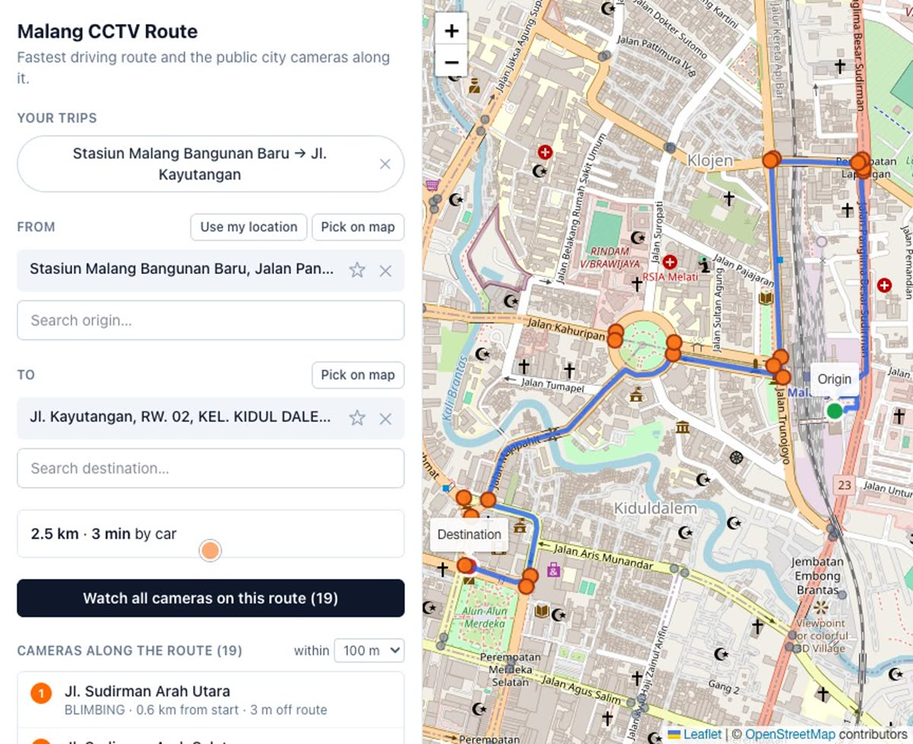
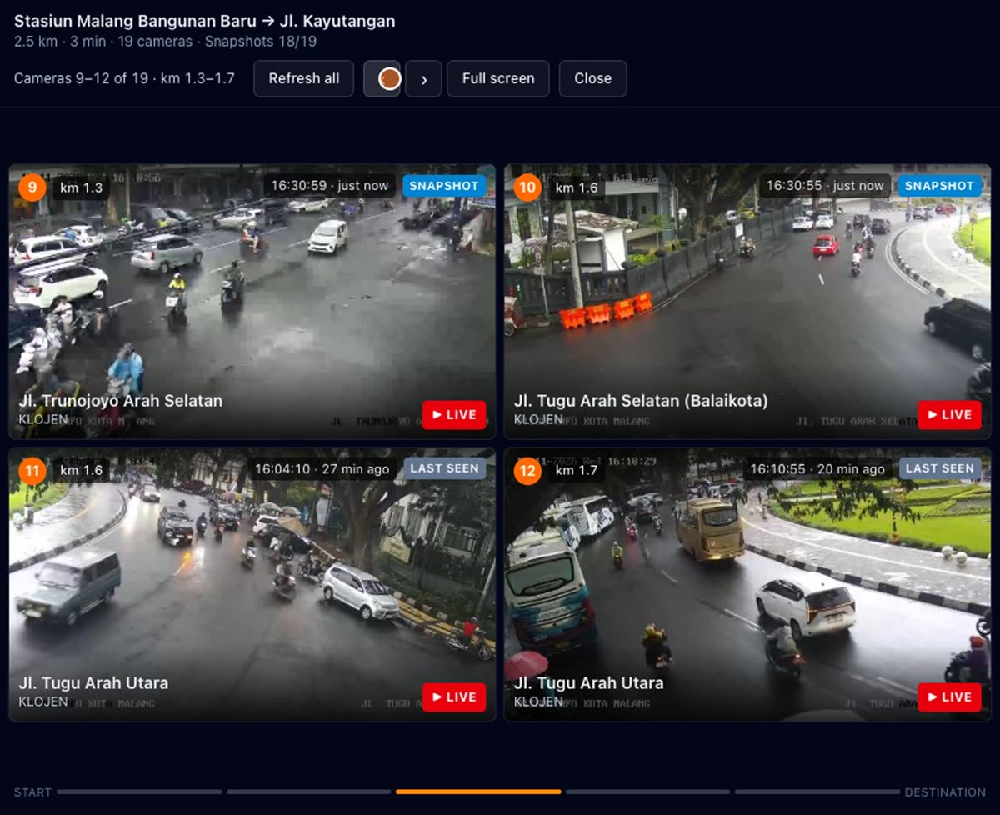

# pantaujalur

See the traffic on your route before you leave. Pick where you start and where you are going in Malang, Indonesia, and pantaujalur shows the fastest driving route and every public city CCTV camera along it. Watch one camera live, or open them all at once as a wall of photos, ordered from your start to your destination.

<p>
  
  
</p>

It is an unofficial client of the city's public CCTV map at <https://cctv.malangkota.go.id/sebaran-cctv>. It needs no API keys and no accounts: maps are OpenStreetMap through Leaflet, routing is OSRM, and place search is Nominatim.

## Run it

You need [Bun](https://bun.sh) 1.4.4 (the version in `packageManager`).

```sh
git clone <this repo> && cd pantaujalur
bun install
bun run dev        # http://localhost:1337
```

`bun run dev` runs the app in Vite with the server code on [workerd](https://github.com/cloudflare/workerd), the same runtime as production. It touches no Cloudflare account.

The server calls the city's CCTV server from your machine, and the city does not answer every network. A home or mobile connection in Indonesia works. If the camera list stays empty and `http://localhost:1337/api/cameras` answers `502` with `HTTP 403`, the city refuses your network: run the relay below on a connection it accepts, and point the app at it.

## How it works

```text
browser ──► app server (TanStack Start) ──► cctv.malangkota.go.id   camera list, HLS streams
   │                                    ──► OSRM, Nominatim          route, place search
   └──► OpenStreetMap tiles
```

1. **Pick a trip.** The start comes from your GPS by default, or from a search or a tap on the map. An XState machine owns that input flow (`src/flow/route-flow-machine.ts`). Recent trips and places, and names you give them ("Home", "Work"), stay in your browser's `localStorage` (`src/places/`).
2. **Route and cameras.** OSRM returns the fastest driving route. `camerasAlongRoute` (`src/domain/`) projects every camera onto the route, keeps those within 50, 100 or 200 m of it, and orders them by distance from the start. TanStack Query fetches all server data (`src/queries.ts`, `src/server/functions.ts`).
3. **Live video.** The city's streams are HLS. The browser cannot load them directly (see "Upstream endpoints"), so the app proxies them at `/api/stream/{file}`, and hls.js plays them.
4. **The camera wall.** "Watch all cameras on this route" opens every camera at once, nearest first, left to right toward the destination. Each tile is a still photo, not live video, so a wall costs the city one playlist and one short segment per camera instead of a stream per tile. Captures run at most three at a time, the visible page first. Photos stay in IndexedDB, so reopening the wall or reloading the page shows them at once, for free. A photo is captured again only when it is 15 minutes old, or when you tap it. Each tile's Live button plays that one camera.

The city's cameras come and go. A stream that has stopped still serves its last segments, so its tile shows that last photo under a "Last seen" badge with its real time. A camera with no stream at all shows "No signal" and is asked again after 5 minutes. A failed capture is retried twice, after 2 and 5 seconds, before a tile gives up.

| Piece                                                                | Where                                                                                   |
| -------------------------------------------------------------------- | --------------------------------------------------------------------------------------- |
| Domain types and `camerasAlongRoute`                                 | `src/domain/`                                                                           |
| Input flow (XState)                                                  | `src/flow/route-flow-machine.ts`                                                        |
| Shared upstream CCTV session, and the one upstream call, `cctvFetch` | `src/server/cctv-session.ts`                                                            |
| Camera list, `GET /api/cameras`                                      | `src/routes/api/cameras.ts`, `src/server/cctv-cameras.ts`                               |
| HLS stream proxy, `GET /api/stream/{file}`                           | `src/routes/api/stream/$file.ts`                                                        |
| Map, camera list, live player                                        | `src/components/`                                                                       |
| Camera wall and its snapshot queue                                   | `src/components/CameraWall.tsx`, `snapshotQueue.ts`, `captureFrame.ts`, `frameStore.ts` |
| CCTV relay, for hosting on a network the city refuses                | `relay/`                                                                                |
| Cloudflare deploy (Alchemy)                                          | `alchemy.run.ts`, `.github/workflows/deploy.yml`                                        |

## Upstream endpoints

| Endpoint                                                       | Use                                                                                                                            |
| -------------------------------------------------------------- | ------------------------------------------------------------------------------------------------------------------------------ |
| `GET /sebaran-cctv`                                            | Sets the session cookies (`ci_session`, `nancy_auth_v1c`, `NANCY_TOKEN_W`, `NANCY_TOKEN_Q`). The tokens expire after one hour. |
| `POST /api/v2/get-cameras` with form field `m_kecamatan_id=99` | All cameras (about 251). Without valid cookies it returns HTTP 200 with `msg_main.status: false`.                              |
| `GET /cctv-stream/streams/{stream_id}.m3u8`                    | Live HLS playlist. Segments are relative names such as `{stream_id}_0p0870.ts` in the same folder.                             |

The stream server returns 403 unless a request has the session cookies, a full desktop browser `User-Agent`, and the map page as `Referer`. A browser cannot set those headers for another site, so the app's server adds them. The proxy accepts only names matching `^\d+(_[0-9p]+)?\.(m3u8|ts)$` and answers 400 to anything else, so it cannot fetch other upstream paths. The server keeps one session, replaces it after 50 minutes, and when the city rejects it, opens a new one and retries once.

## Hosting on Cloudflare

The app deploys to a Cloudflare Worker with [Alchemy](https://alchemy.run). The Workers Free plan is enough for personal use: 100,000 requests a day, where a live viewer costs about one request a second and a whole wall about two per camera.

**The catch: the city refuses Cloudflare.** `cctv.malangkota.go.id` answers `403 Forbidden` to Cloudflare's egress IPs, so a deployed Worker cannot reach it directly. It goes through a small relay instead, running on a machine the city accepts (such as a home server in Indonesia), exposed through a Cloudflare Tunnel so the machine needs no open port.

```text
Worker ──HTTPS──► relay hostname ──Cloudflare Tunnel──► cloudflared ──► relay:8080 ──► cctv.malangkota.go.id
```

The relay (`relay/server.ts`) is a Bun server of about 100 lines. It answers only requests carrying the shared secret in `x-relay-secret`, and forwards only the three upstream calls above: `GET /sebaran-cctv`, `POST /api/v2/get-cameras`, and `GET /cctv-stream/streams/{file}` for a file the proxy also accepts. Anything else gets 401 or 404. It forwards only the `Cookie`, `User-Agent`, `Referer` and `Content-Type` headers. `GET /healthz` needs no secret.

### Deploy

1. Make a Cloudflare API token with Workers Scripts: Edit, Secrets Store: Edit and Cloudflare Tunnel: Edit on the account, and Zone: Read and DNS: Edit on the zone for the relay hostname (and the app's domain, if you use one).
2. Make a relay secret: `openssl rand -hex 32`.
3. Set these repo secrets for the `deploy` workflow, which deploys every push to `main`:

   | Secret                  | Value                                                                       |
   | ----------------------- | --------------------------------------------------------------------------- |
   | `CLOUDFLARE_API_TOKEN`  | The token                                                                   |
   | `CLOUDFLARE_ACCOUNT_ID` | Your account id                                                             |
   | `CCTV_RELAY_SECRET`     | The relay secret                                                            |
   | `RELAY_HOSTNAME`        | The relay's public hostname, such as `cctv-relay.example.com`               |
   | `RELAY_ZONE`            | The zone it lives on, such as `example.com`                                 |
   | `APP_DOMAIN`            | Optional custom domain for the app. Without it, the app is on `workers.dev` |

   Or deploy from your machine with the same values as environment variables: `bun run deploy`. The first deploy creates the Worker, the tunnel and the relay's DNS record. Without the secrets, as in a fork, the workflow skips.

4. Install the relay on a machine with Docker that you reach over ssh, and that the city accepts:

   ```sh
   RELAY_SSH_HOST=my-server CCTV_RELAY_SECRET=... CLOUDFLARE_API_TOKEN=... CLOUDFLARE_ACCOUNT_ID=... \
     bun run relay:deploy
   ```

   It copies `relay/` to `~/pantaujalur-relay` on the machine, writes its `.env` (mode 600, secrets sent over ssh's standard input, never on a command line), fetches the tunnel's token, and runs the Compose project `pantaujalur-relay` with the `relay` and `cloudflared` services. Run it again after any change to `relay/`. It is idempotent.

5. Check it: `https://<your app>/api/cameras` should list the cameras. A `502` names the step that failed. "HTTP 401" means the Worker's and the relay's secrets differ, and "HTTP 502" or "530" means the tunnel or the relay is down.

To develop against the relay instead of the city, forward its port and set both variables:

```sh
ssh -N -L 8787:127.0.0.1:8787 my-server &
CCTV_UPSTREAM_URL=http://127.0.0.1:8787 CCTV_RELAY_SECRET=... bun run dev
```

## Scripts

| Command               | What it does                                                                                                          |
| --------------------- | --------------------------------------------------------------------------------------------------------------------- |
| `bun run dev`         | The app on <http://localhost:1337>                                                                                    |
| `bun run test`        | Unit tests: `camerasAlongRoute`, the input flow, the CCTV session, the snapshot queue, saved places and the relay     |
| `bun run typecheck`   | `bun check -b` over `tsconfig.app.json` and `tsconfig.node.json`                                                      |
| `bun run lint`        | `bun lint` and `bun fmt --check`. `bun run format` fixes what it can                                                  |
| `bun run build`       | The Worker into `dist/server`, the static files into `dist/client`                                                    |
| `bun run e2e`         | Drives `bun run dev` in headless Chrome from a search to a playing camera                                             |
| `bun run e2e:wall`    | Drives the camera wall at desktop and phone sizes, and prints what one wall open costs the city in requests and bytes |
| `bun run e2e:places`  | Drives saved places and trips at phone size                                                                           |
| `bun run demo:record` | Records a walkthrough of the running app and edits it with Remotion (`video/`) into a square, captioned MP4           |

The e2e scripts use your installed Google Chrome. Set `BROWSER_CHANNEL=chromium` to use Playwright's own browser, and `BASE_URL` to test a deployed app.

## Known limits

- This is not an official app. The city's endpoints are undocumented and can change without notice. Please keep the load low: the wall's snapshot design exists for that.
- Many cameras are offline at any given time. That is the city's side, not the app's.
- OSRM (`router.project-osrm.org`) and Nominatim (`nominatim.openstreetmap.org`) are public demo servers, rate-limited and not for heavy use. Search waits for typing to pause for 450 ms, since Nominatim allows one request a second.
- Nominatim ranking is loose: for "Stasiun Malang", a street named "Jalan Stasiun" can come first.
- Directional cameras ("Arah Utara", northbound) are matched by position, not by your direction of travel.
- The camera list (10 minutes) and the upstream session (50 minutes) are cached in server memory, per Workers isolate.

## License

[MIT](LICENSE)
